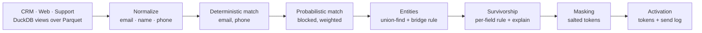

# Zero-Copy Identity Resolution

**Resolve customer records from three disagreeing systems into one explainable profile per person — and be able to defend every merge.**

"Robert Chen" in the CRM, "Bob Chen" with a plus-addressed email on the website, and "rob chen" in a support ticket are the same person. Two colleagues who share an email domain are not. This Python project implements the full identity-resolution path — normalize, match, cluster, pick surviving values, mask, activate — with every decision recorded so you can answer *"why does this profile say what it says?"*

The design premise is **zero-copy**: sources are read in place as DuckDB views over Parquet, segments are built from masked attributes, and activation sends tokens rather than copies of customer data.



## Engineering decisions worth looking at

- **Deterministic first, fuzzy second.** Exact matches on normalized email/phone resolve most pairs cheaply; only the remainder is scored. A strong key shared by more than five records on one side (a support inbox, a switchboard number) is ignored instead of merging everyone who used it.
- **Conservative normalization.** Plus-addressing is stripped, but dots in email local parts are *not* (`j.smith` ≠ `jsmith` at most companies). Nicknames map (`Bob → Robert`), but `Alex` does not become `Alexander`. Tests guard both choices.
- **Blocking plus weighted scoring.** Candidates are compared only within an `email domain + name initial` block. Name agreement carries 55% of the score; email domain only 5%, because everyone at a company shares it.
- **No weak bridges.** Clusters are built with union-find, strongest pairs first. A pair below 0.90 confidence may attach a loose record but may never join two existing multi-record clusters — one bad link can't chain unrelated people together.
- **Survivorship with receipts.** Each profile field records its source, the rule that chose it (unanimous / most recent / source precedence / tie-break), and the competing values that lost.
- **Stable IDs and incremental updates.** Entity IDs are a hash of the member set, so reruns don't renumber profiles. Incremental updates re-score only the blocks new records land in, and `equivalent_to_full()` checks the result against a full rebuild.

## Example

The CRM/web pair from above, scored by `score_pair`:

```python
from idres.probabilistic import score_pair

crm = {"_id": "c1", "_source": "crm", "name": "Robert Chen",
       "email": "robert.chen@northwind.example", "company": "Northwind"}
web = {"_id": "w1", "_source": "web", "name": "Bob Chen",
       "email": "bob.chen+news@northwind.example", "company": "Northwind"}

total, breakdown = score_pair(crm, web)
# total ≈ 0.92  (match threshold: 0.82)
# name=1.00 (identical token set), email_local=0.74, email_domain=1.00, company=1.00
```

## Quick start

Requires Python 3.10+.

```bash
git clone https://github.com/AliAzamat/zero-copy-identity-resolution.git
cd zero-copy-identity-resolution
pip install duckdb pytest

python -m pytest -q    # 12 tests covering normalization, matching, bridging, survivorship
```

`duckdb` is only needed by `idres/sources.py`; the matching, clustering, and survivorship modules use the standard library.

## Project layout

| Module | Responsibility |
|---|---|
| `idres/sources.py` | Registers CRM, web, and support Parquet files as DuckDB **views** (not tables) |
| `idres/normalize.py` | Email, name, and phone normalization; conservative nickname map |
| `idres/deterministic.py` | Exact matching on strong keys with a shared-key guard |
| `idres/probabilistic.py` | Blocking, weighted field scoring, match threshold |
| `idres/entities.py` | Union-find clustering, bridge rule, stable entity IDs |
| `idres/survivorship.py` | Per-field winner selection with an `_explain` block |
| `idres/incremental.py` | Block-scoped updates and a full-rebuild equivalence check |
| `idres/masking.py` | Strips identifier columns; salted, non-reversible tokens |
| `idres/activate.py` | Segment rules over masked attributes; idempotent send log (CLI) |
| `tests/test_resolution.py` | Each test documents the real-world situation it protects |

## Configuration

| Variable | Purpose |
|---|---|
| `IDRES_MASK_SALT` | Per-deployment salt for activation tokens. The default is a development placeholder — set your own value outside the data. |
